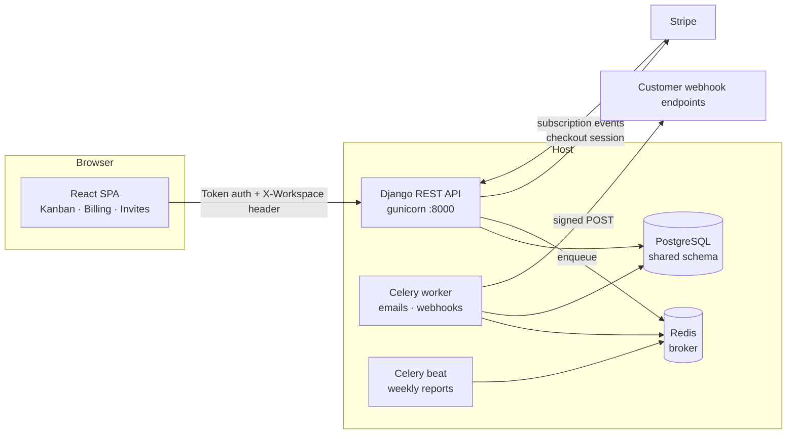

# TeamOrbit: Multi-tenant Project Management SaaS

A Jira-style project management platform where each company gets an isolated workspace with projects, boards, sprints, plan limits, and Stripe billing.

**Stack:** Django REST Framework · Celery + Redis · PostgreSQL 16 · React 18 + Vite + Tailwind · Stripe (test mode) · Docker · GitHub Actions

## Architecture



### Tenant isolation

Every tenant-owned table (`Project`, `Sprint`, `Issue`, `Comment`, `Attachment`, `AuditLog`, `WebhookEndpoint`, `Invitation`) has a `workspace_id` column. The tenant comes from the `X-Workspace` header, which `TenantRolePermission` resolves to a `Membership`. `TenantMixin` then filters every queryset by that workspace, so a request can't read or write another tenant's rows even with a valid ID. Cross-tenant foreign keys are rejected in `TenantSerializer`.

### Data model

| Model | Purpose |
|---|---|
| `Workspace` | Tenant. Holds the plan (`free` or `pro`) and the Stripe customer ID. |
| `Membership` | User in a workspace with a role: `owner` > `admin` > `member` > `viewer`. |
| `Project` | The Kanban board itself. Has a unique key per workspace (e.g. `WEB`) and `columns`, its custom workflow (ordered statuses). |
| `Sprint` | Time-boxed iteration: `planned`, `active`, or `closed`. |
| `Issue` | Work item in a project, with status, server-managed position, optional assignee (unassigned by default), reporter, and optional sprint. |
| `Comment`, `Attachment` | Discussion and files on an issue. Only the author or an admin can change them. |
| `AuditLog` | Append-only record of every mutation, with actor and changed fields. |
| `WebhookEndpoint` | Subscriber URL and shared secret. `events` filters which events it receives. |
| `Invitation` | Email invite. Only the SHA-256 hash of the token is stored. |

### Roles

| Action | viewer | member | admin | owner |
|---|:-:|:-:|:-:|:-:|
| Read projects, issues, and workspace members | ✓ | ✓ | ✓ | ✓ |
| Create, move, and assign issues; comments | | ✓ | ✓ | ✓ |
| Create, edit, and delete projects (their columns) and sprints | | | ✓ | ✓ |
| Invite members, manage webhooks, read audit log | | | ✓ | ✓ |
| Start Stripe checkout | | | | ✓ |

## API overview

All routes are under `/api/` and require `Authorization: Token <key>`. Tenant routes also need `X-Workspace: <slug>`.

| Method and path | Purpose |
|---|---|
| `POST /api/auth/signup/`, `POST /api/auth/login/`, `POST /api/auth/logout/` | Token auth |
| `GET /api/auth/me/` | Current user and their workspaces |
| `POST /api/workspaces/` | Create a workspace (you become owner) |
| `POST /api/invitations/accept/` | Join a workspace with an invite token |
| `GET/POST /api/projects/`, `GET/PATCH/DELETE /api/projects/{id}/` | Projects, which are the boards. `columns` sets the workflow. Delete removes the project with its issues (admin+). |
| `GET /api/members/` | Workspace members for the assignee picker |
| `GET/POST /api/sprints/`, `…/{id}/` | Sprints |
| `GET/POST /api/issues/?project={id}`, `…/{id}/` | Issues; filter by project. `PATCH {assignee: user_id}` assigns, `null` unassigns. |
| `POST /api/issues/{id}/move/` | Body `{status, index}`. Reinserts the issue and renumbers the column. |
| `GET/POST /api/comments/?issue={id}`, `…/{id}/` | Comments (author or admin to edit) |
| `GET/POST /api/attachments/`, `…/{id}/` | Attachments (validated extension, size, and magic bytes) |
| `GET/POST /api/invitations/`, `DELETE …/{id}/` | Invites (admin+) |
| `GET/POST /api/webhooks/`, `…/{id}/` | Webhook endpoints (admin+) |
| `GET /api/audit-logs/` | Audit trail (admin+) |
| `POST /api/billing/checkout/` | Stripe Checkout session URL (owner only) |
| `POST /billing/webhook/` | Stripe webhook. Verifies the signature, then updates the plan. |

Errors: `400` validation, `401` bad credentials, `403` role or tenant denied, `402` plan limit reached.

### Webhook payload

Each event is POSTed as JSON with an `X-Signature-SHA256` header, which is the HMAC-SHA256 of the raw body using the endpoint's secret. Event names look like `issue.create`, `issue.move`, `project.update`, or `*` to receive everything.

## Background jobs

| Task | Trigger | What it does |
|---|---|---|
| `emit_event` → `deliver_webhook` | Every mutation | Fans out signed webhook POSTs with retries and exponential backoff |
| `notify_assignee` | Assignee changed | Emails the new assignee |
| `send_invite_email` | Invite created | Emails the invite link |
| `generate_weekly_reports` | Celery beat, weekly | Writes per-sprint status counts for active sprints |

## Local development

Requires Docker and Node 20+.

```bash
docker compose up --build                 # api :8000, postgres, redis, celery worker and beat
cd frontend && npm install && npm run dev # http://localhost:5173
```

1. Open the frontend and click **Sign up**.
2. Create a workspace. You become its owner.
3. Create a project. The project is its own Kanban board. Invite teammates by email. Invite emails print to the console in development.
4. As owner, click **Upgrade to Pro** to start Stripe Checkout in test mode. Use `STRIPE_SECRET_KEY` and `STRIPE_PRICE_PRO` from your Stripe test dashboard in `docker-compose.yml`.

## Tests

```bash
# Backend: 30 tests covering tenant isolation, roles, invites, plan limits, attachments, Kanban moves, assignees, project deletion, and Stripe webhooks
cd backend && python manage.py test

# Frontend: 12 tests covering the API client, Kanban drag and drop, and the assignee picker
cd frontend && npm test

# Production build
cd frontend && npm run build
```

CI runs all three on every push and pull request (see `.github/workflows/ci.yml`).

## Production deploy

On every push to `main`, CI builds the backend image, pushes it to GitHub Container Registry (`ghcr.io/<owner>/<repo>/backend`), then SSHes into the host and runs `docker-compose.prod.yml`, which applies migrations.

Configure these repository **secrets** (Settings > Secrets and variables > Actions):

| Secret | Purpose |
|---|---|
| `DEPLOY_HOST` | Host address |
| `DEPLOY_USER` | SSH user with Docker access |
| `DEPLOY_SSH_KEY` | Private key for that user |
| `DEPLOY_PATH` | Directory on the host containing `docker-compose.prod.yml` and `.env` |
| `GHCR_PULL_TOKEN` | Personal access token with `read:packages`, so the host can pull the private image |

The host needs Docker with the Compose plugin and a `.env` with production values: `DJANGO_SECRET_KEY`, Postgres credentials, `POSTGRES_HOST=db`, `REDIS_URL=redis://redis:6379/0`, Stripe keys, and `FRONTEND_URL`. Put a TLS reverse proxy in front of port 8000.

## Brief alignment

| Milestone | Status | Where |
|---|---|---|
| 1. Tenant isolation, models | Done | Shared schema with `workspace_id`; see Architecture |
| 2. REST API with per-role permissions | Done | Django REST Framework; `permissions.py`, `mixins.py` |
| 3. Drag-and-drop Kanban in React | Done | `KanbanBoard.jsx`, native HTML5 drag and drop, tested. The project is the board. |
| 4. Custom workflows, comments, attachments, audit log | API done. UI partial. | `Project.columns`, `Comment`, `Attachment`, `AuditLog` |
| 5. Webhooks and background jobs with Celery | Done | `tasks.py`, `config/celery.py` |
| 6. Stripe billing in test mode with plan limits | Done | `billing.py`, Upgrade button in the Overview page |
| 7. Docker and GitHub Actions test and deploy | Done | `Dockerfile`, `docker-compose*.yml`, `ci.yml` |

**Stack note:** the brief lists Express, Prisma, TypeScript, and Vitest, but its milestones specify Django REST Framework and Celery. This repo follows the milestones: the backend is Django REST Framework, and Vitest tests the React frontend. The frontend is still JavaScript rather than TypeScript.

## Known gaps

- **Frontend is JavaScript, not TypeScript.** Converting the six source files is a planned follow-up.
- **No sprint UI.** Sprints work through the API only.
- **No comment or attachment UI.** The API handles both.
- **No custom workflow editor.** Columns can be set on create or through the API (`PATCH /api/projects/{id}/`) but there is no UI.
- Auth is token-only, with no password reset or email verification.
- No rate limiting on login or signup.
- Webhook URLs aren't restricted, so a workspace admin can point a webhook at internal addresses. An allowlist or private-address block is needed before production.
- Invite tokens travel through the Celery broker. A stronger design would send only the invitation ID.
- Stripe plan downgrades don't remove existing projects or members, so they stay over the free limit.
